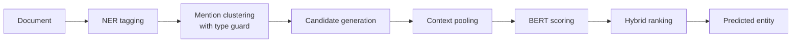

# ContaiNED: Type-Constrained Mention Clustering for Zero-Shot Named Entity Disambiguation

Honours research project, Department of Computer Science, Rhodes University (2026).
**Author:** Theodore Masi · **Supervisor:** Marc Marais

ContaiNED is a zero-shot named entity disambiguation (NED) pipeline. It links ambiguous mentions in text (*Amazon* the company or *Amazon* the forest?) to Wikipedia entities **without training or fine-tuning any model** and without annotated data from the target domain.

Instead of resolving each mention on its own, ContaiNED groups mentions that refer to the same entity within a document, pools their surrounding context, and makes one decision per group. A **container class** mechanism uses predicted entity types (person, organisation, location, misc) to stop mentions of different types from being grouped together.

▶ **Run it on Kaggle (free GPU):** https://www.kaggle.com/code/theomasi/contained

## How it works

1. **NER tagging.** `dslim/bert-base-NER` predicts a coarse type (PER, ORG, LOC, MISC) for each gold mention.
2. **Mention clustering.** Mentions are grouped longest-first, merging when one name contains the other or their Levenshtein ratio is at least 0.85. In the container class configuration, mentions of different predicted types are never merged.
3. **Candidate generation.** Candidates come from the ZELDA alias table (exact, case-insensitive, then core-name match), with live Wikipedia search as a fallback.
4. **Context pooling.** Each mention contributes a 200-character window on either side, and windows in a group are concatenated.
5. **Hybrid ranking.** Candidates are scored as `0.40 × semantic + 0.35 × string + 0.25 × prior`, where semantic similarity comes from the frozen `sentence-transformers/bert-base-nli-mean-tokens` encoder.

The only difference between the baseline and container class configurations is the type guard in step 2.

## Repository contents

| File | Contents |
|---|---|
| `contained.ipynb` | The full pipeline and all three experiments |
| `requirements.txt` | Python dependencies |
| `CITATION.cff` | Citation metadata |
| `LICENSE` | MIT licence |

## Running it

The easiest way is the [Kaggle notebook](https://www.kaggle.com/code/theomasi/contained), which already has the data attached and a free GPU.

To run it elsewhere:

1. Install the dependencies: `pip install -r requirements.txt`
2. Download the ZELDA test splits and candidate lists from the [ZELDA repository](https://github.com/flairNLP/zelda).
3. Update `ZELDA_DIR`, `CANDIDATE_PICKLE` and `IDS_PICKLE` near the top of the notebook to point at your copies.
4. Run the smoke test cell before the full evaluation.

The full evaluation of both configurations took about 7.7 hours on a single N
